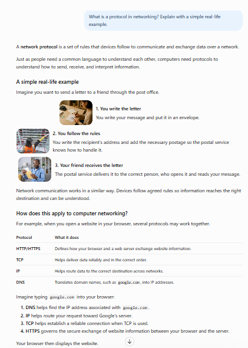
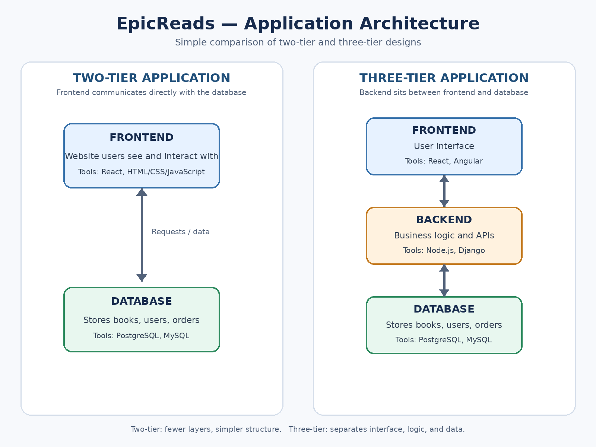
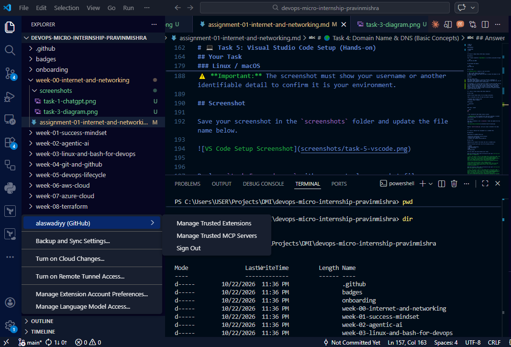

# Week 00 - Internet and Networking

Part of the DevOps Micro Internship (DMI) with Agentic AI

---

# 🧑‍💻 Task 1: Using ChatGPT as Your Learning Assistant

## Scenario

You're new to DevOps and will frequently encounter technical questions. ChatGPT can be your learning companion.

## Your Task

Write a clear ChatGPT prompt to help you understand:

> "What is a protocol in networking? Explain with a simple real-life example."

Take a screenshot of your interaction showing:

* Your detailed prompt (with clear expectations)
* ChatGPT's simplified response with an example

## Screenshot

Save your screenshot in the `screenshots` folder and update the file name below.




Replace `task-1-chatgpt.png` with your actual screenshot file name.

---

## What I Learned (2–3 lines)


A network protocol is a set of rules that allows devices to communicate and exchange data over a network.
Examples include HTTP/HTTPS for web communication, TCP for reliable data delivery, IP for routing data, and DNS for translating domain names into IP addresses.


# 🌐 Task 2: Internet and Networking

## Scenario

Your friend is launching an online bookstore named **EpicReads**.

He asked you to explain how users globally can access his website hosted in Finland.

## Your Task

Write a short explanation (**100–150 words**) that includes:

* Packet Switching
* IP Address
* TCP/IP
* HTTP/HTTPS

💡 **Tip:** You may use ChatGPT (as demonstrated in Task 1) to refine your explanation.

## Answer


EpicReads is an online bookstore hosted on a server in Finland, but users around the world can access it through the internet.

When a user visits the website, Packet Switching breaks the data into small packets that travel across different networks to reach the user's device. Each device connected to the internet has an IP Address, which helps identify it and route data to the correct destination.

TCP/IP is a suite of protocols that enables communication between devices. IP handles addressing and routing, while TCP helps ensure data is delivered reliably and in the correct order.

HTTP/HTTPS allows the user's browser to communicate with the EpicReads web server and request web pages. HTTPS adds encryption to protect information exchanged between the browser and server.

Together, these technologies allow customers worldwide to browse books, view prices, and shop on EpicReads, regardless of their location.


# 🏗️ Task 3: Application Architecture & Stack

## Scenario

EpicReads bookstore has two application versions:

### Two-Tier Application

* Frontend
* Database

### Three-Tier Application

* Frontend
* Backend
* Database

## Your Task

* Draw simple diagrams (hand-drawn or tool-based such as draw.io)
* Label each layer clearly
* List at least two common technologies or tools used for each layer
* Submit a screenshot or photo clearly showing your own drawing

## Diagram Screenshot / Photo

Save your diagram image in the `screenshots` folder and update the file name below.




Replace `task-3-diagram.png` with your actual diagram file name.

---

## Technologies Used

### Frontend

* HTML
* CSS
* Javascript
* React

### Backend

* Node.js
* Django

### Database

* PostgreSQL
* MySQL

---

# 🌍 Task 4: Domain Name & DNS (Basic Concepts)

## Scenario

Your friend's bookstore **EpicReads** is currently accessible through:

```text
52.172.142.222:3000
```

He purchased the domain:

```text
epicreads.com
```

## Your Task

In **50–100 words**, explain in your own words:

1. What is DNS (Domain Name System)?
2. Which DNS record type should be used to connect the domain to the given IP, and why?

## Answer


DNS (Domain Name System) is like the internet's phonebook. It translates human-readable domain names, such as epicreads.com, into IP addresses that computers use to find servers.

For EpicReads, an A record should be created to point epicreads.com to the IPv4 address 52.172.142.222. This allows users to access the website using its domain name instead of memorizing the IP address. However, because the website currently uses port 3000, additional configuration may be needed to make it accessible through the domain without specifying the port.

# 💻 Task 5: Visual Studio Code Setup (Hands-on)

## Your Task

Install Visual Studio Code (if not already installed).

Take a screenshot of your VS Code environment showing:

* Terminal open inside VS Code
* Running a basic command:

### Windows

```powershell
dir
```

### Linux / macOS

```bash
pwd
ls
```

* Your selected VS Code theme clearly visible

⚠️ **Important:** The screenshot must show your username or another identifiable detail to confirm it is your environment.

## Screenshot

Save your screenshot in the `screenshots` folder and update the file name below.




Replace `task-5-vscode.png` with your actual screenshot file name.

---

# 🔗 Task 6: Publish Your Assignment as a LinkedIn Post

## Objective

Publishing on LinkedIn helps you:

* Build your professional online presence
* Reinforce your learning
* Document your DevOps journey publicly

## Your Task

Summarize your answers from Tasks 1–5 into a LinkedIn post.

Clearly structure your post into the following sections:

* ChatGPT
* Internet & Networking
* App Architecture
* DNS
* VS Code Setup

Use the credit note that matches your track:

Add the following credit note at the end of your post **(If you are DMI Cohort 3 student)**:

> **P.S. This post is part of the DevOps Micro Internship (DMI) with Agentic AI — Cohort 3 — by Pravin Mishra. My graded progress is public: https://dmi.pravinmishra.com/s/YOUR-GITHUB-USERNAME.html · Start your DevOps journey: https://dmi.pravinmishra.com/?utm_source=student&utm_medium=ps-linkedin&utm_campaign=cohort3**

**Tag [Pravin Mishra](https://www.linkedin.com/in/pravin-mishra-aws-trainer/) in your LinkedIn post, then tag Lead Co-Mentor — [Anjana Muthunayake](https://www.linkedin.com/in/anjana-muthunayake/).**

Add the following credit note at the end of your post **(If you are DMI Self-paced track student)**:

> **P.S. This post is part of the DevOps Micro Internship (DMI) — Self-Paced Engineer Track — by Pravin Mishra. My graded progress is public: https://dmi.pravinmishra.com/s/YOUR-GITHUB-USERNAME.html · Start your DevOps journey: https://dmi.pravinmishra.com/?utm_source=student&utm_medium=ps-linkedin&utm_campaign=self-paced**

Add the following credit note at the end of your post **(If you are DMI Campus student)**:

> **P.S. This post is part of the DevOps Micro Internship (DMI) — Campus — by Pravin Mishra. My graded progress is public: https://dmi.pravinmishra.com/s/YOUR-GITHUB-USERNAME.html · Start your DevOps journey: https://dmi.pravinmishra.com/?utm_source=student&utm_medium=ps-linkedin&utm_campaign=campus**

**Tag [Pravin Mishra](https://www.linkedin.com/in/pravin-mishra-aws-trainer/) in your LinkedIn post, then tag Lead Co-Mentor — [Anjana Muthunayake](https://www.linkedin.com/in/anjana-muthunayake/).**

Hashtags:

#DMIByPravinMishra #AgenticAI #DevOps

Replace `YOUR-GITHUB-USERNAME` with your GitHub username — that link is your public DMI progress page (your graded badge page).
---

## LinkedIn Post URL

Paste your LinkedIn post URL here:

```text
https://lnkd.in/p/dEz4daTz
```

---

## LinkedIn Post Backup Copy

Paste the full text of your LinkedIn post here:

🚀 Turning DevOps Knowledge into Practical Projects | DMI Cohort 4
I’m building my understanding of DevOps step by step through the DevOps Micro Internship (DMI) with Agentic AI. Here are some of the key things I’ve learned so far for the first week.

🤖 ChatGPT
I explored how ChatGPT can support learning, explain technical concepts, and help me understand new tools and technologies.
🌐 Internet & Networking
I learned what network protocols are and how technologies such as Packet Switching, IP addresses, TCP/IP, and HTTP/HTTPS help devices communicate across the internet.
🏗️ App Architecture
I explored the difference between two-tier and three-tier applications. A two-tier application has a frontend and database, while a three-tier application adds a backend layer to handle business logic and communication between the frontend and database.
🌍 DNS
I learned that the Domain Name System (DNS) translates domain names into IP addresses. For EpicReads, an A record can point epicreads.com to the server's IPv4 address, 52,172,142,222. Since the application uses port 3000, additional configuration may be required to access it without specifying the port.
💻 VS Code Setup
I explored setting up Visual Studio Code as a development environment for writing, managing, and organizing code while working on technical projects.
Each task has helped me strengthen my foundational knowledge of the internet, application architecture, and the tools used in software development and DevOps.
I'm looking forward to applying these concepts in practical projects and continuing to learn! 📚
Thanks to Pravin Mishra and Lead Co-Mentor Anjana Muthunayake for facilitating this learning journey.

#DevOps #DMICohort4 #AgenticAI #Networking #DNS #SoftwareDevelopment #ContinuousLearning
P.S. This post is part of the DevOps Micro Internship (DMI) with Agentic AI — Cohort 4 — by Pravin Mishra. My graded progress is public:
https://lnkd.in/dsU5DRGz
Start your DevOps journey: https://lnkd.in/d8NZ_Hwe

# Reflection – Week 0

### What did you find easy?

Add your answer here...
I find using ChatGPT easy
---

### What was difficult?

Add your answer here...
None
---

### What will you improve next week?

Add your answer here...
Nothing for now
---

## 📌 About DMI & CloudAdvisory

DevOps Micro Internship (DMI) is a project-based DevOps program run by Pravin Mishra (The CloudAdvisory) focused on real-world execution, systems thinking, and career readiness.

It helps learners build strong DevOps foundations with hands-on experience.


## 📌 Resources

- 🌐 **DMI Official Website:** https://dmi.pravinmishra.com?utm_source=github&utm_medium=readme  
- 🎓 **University:** https://university.pravinmishra.com?utm_source=github&utm_medium=readme  
- 💬 **Discord Community:** https://discord.pravinmishra.com?utm_source=github&utm_medium=readme  
- 📝 **Blog:** https://dmi.pravinmishra.com/blog?utm_source=github&utm_medium=readme  
- ▶️ **YouTube Playlist (DMI Cohort 3):** https://www.youtube.com/playlist?list=PLFeSNDtI4Cho  
- 🔗 **Pravin Mishra (LinkedIn):** https://www.linkedin.com/in/pravin-mishra-aws-trainer/  
- 🏢 **CloudAdvisory (LinkedIn):** https://www.linkedin.com/company/thecloudadvisory/

---

*This submission is part of DevOps Micro Internship (DMI) — Agentic AI Track*